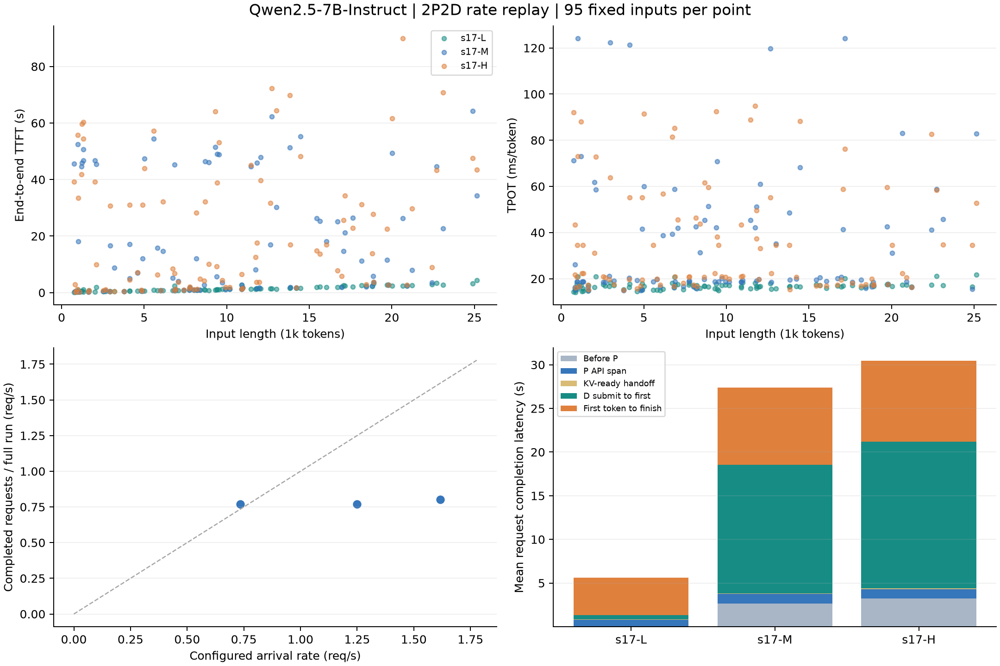
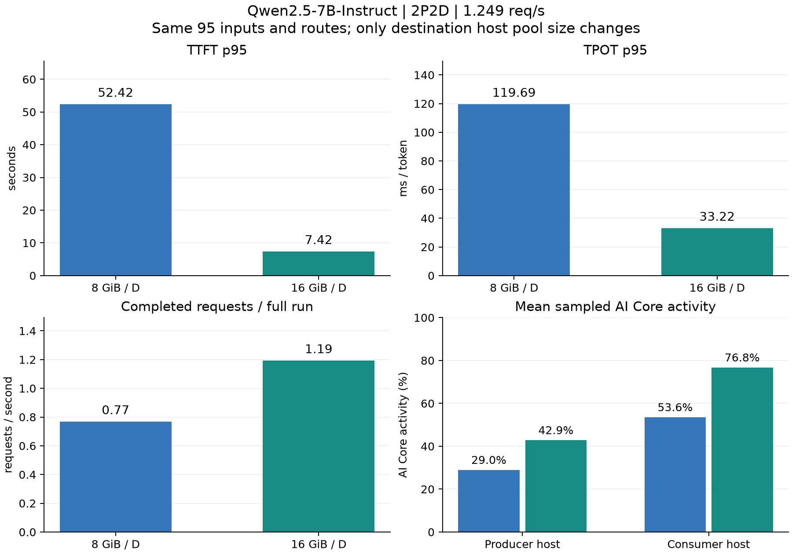

# Qwen2.5 2P2D 初步性能实验结果

日期：2026-10-16。完成 3 个速率点各 95 条请求，以及 1 个同负载内存对照点 95 条请求；共 380 次测量请求，379 次成功。

本轮主要发现是 **D 端 pinned CPU 内存池的分配压力会放大排队与回退，并降低实际算力利用率**。把每个 D 的池从 8 GiB 增到 16 GiB 后，同负载 TTFT p95 降低 85.9%，TPOT p95 降低 72.2%，全轮完成吞吐提高 55.2%。这是一个种子、一次同负载对照的初步证据。

## 实际条件

- 81 上 P0/P1，91 上 D0/D1；每实例一张 910B2、TP=1/PP=1。每节点 CPU quota 为 8 cores，容器内存限额 64 GiB。
- 模型目录 `/data/shared_models/Qwen2.5-7B-Instruct`，BF16，32K 上下文，D 输出固定 256 tokens。P 的 1 个内部输出 token 不发送给客户端。
- 固定轨迹 revision `3f5b93ff1c5ea84b2c94cf479d0c942227191b4a`；指定 8 会话的 95 个历史快照；两会话 32 个快照独立用于标定。
- 输入采用 Qwen tokenizer/chat template，完整保留指定步骤之前的可见历史；不同速率使用相同输入顺序、到达间隔基序列与随机路由，seed=17。
- 开环 Poisson 到达；P 交替、D 独立随机选择。缓存通过 NPU→CPU→RDMA→CPU→NPU 路径；每请求使用独立 cache salt。
- RDMA 原速，无额外后台竞争流量。6 秒 CPU RDMA 标定有效吞吐为 90.65 Gb/s。
- 每实例运行序列上限 8，NPU KV 预算 16 GiB；源 CPU 池 8 GiB/实例；目标 CPU 池的 8/16 GiB 为对照变量。
- 源端每 P 设 6 GiB 待恢复字节预算，D 首 token 后释放预算；等待单独计时。源/目标布局、模型和输入在内存对照中保持一致。
- graph 与异步调度开启；默认 OS 调度优先级。引擎 `PEGAFLOW_SYNC_SAVE=1` 与工作线程完成同步共同保证源 KV 真正可见。

## 主结果

| 组别 | 配置速率 req/s | 每 D host 池 GiB | 成功 | TTFT p50 s | TTFT p95 s | TPOT p95 ms | 全轮完成 req/s | 完整远端复用 |
|---|---:|---:|---:|---:|---:|---:|---:|---:|
| s17-L | 0.735 | 8 | 94/95 | 1.06 | 2.83 | 20.65 | 0.769 | 94 |
| s17-M | 1.249 | 8 | 95/95 | 8.12 | 52.42 | 119.69 | 0.769 | 90 |
| s17-H | 1.616 | 8 | 95/95 | 9.94 | 64.37 | 88.92 | 0.801 | 84 |
| 同负载内存对照 | 1.249 | 16 | 95/95 | 1.77 | 7.42 | 33.22 | 1.194 | 95 |

延迟统计针对成功请求；失败单列并保留在请求分母中。低速组有 1 次 HTTP ReadError，随后把客户端连接保活设为 2 秒，之后三组均完成 95/95。内存对照与原中负载使用相同客户端设置。

“全轮完成吞吐”包含发送与排空阶段；配置速率是 Poisson 参数，单轮实际到达率有有限样本偏差。这些值不能直接当作严格稳态容量。

## 资源与阶段证据

1. 8 GiB 中/高负载分别出现 5/11 条未完整远端复用的请求；D 端日志记录了大块 pinned slab 分配失败，工作线程记录的额外 prompt 计算最大达 24,900 tokens。
2. 16 GiB 中负载对照中，95 条均完整远端复用，D 剩余 prompt 计算在 5–120 tokens；源端字节预算等待 p95 从约 20.97 秒降到约 0.01 ms。
3. 成功完成 RDMA 的请求，其总 fetch 阶段 p95：低速 136.58 ms、中速 196.37 ms、高速 391.57 ms、16 GiB 对照 133.08 ms。分配失败/回退另行计数，不混入这组成功传输的延迟分布。
4. 中负载下 D 提交至首 token 的均值由 14.73 秒降到 1.72 秒；P API span 均值约为 1 秒。已有证据支持接收端内存与恢复/计算排队是这次长尾的重要来源。
5. 两端 AI Core 采样峰值均为 100%。同一中负载下，P 端平均从 29.0% 升到 42.9%，D 端平均从 53.6% 升到 76.8%。均值只使用该测量点首个请求到最后完成的窗口，排除人为暂停与服务启动时间。
6. 该中负载下 CPU 平均使用约 P 端 0.82、D 端 2.93 cores，16 GiB 对照为 1.07、3.36 cores；两端均未记录 CPU quota 节流，额度为每节点 8 cores。

当前结果不能把几十秒的 TTFT 长尾归因于网络传输本身，也不能证明模型计算已经达到硬件算力上限。内存池扩大对照支持内存分配压力是重要因素；prefetch 并发、在用引用、slab 分配及 D 计算排队的具体占比仍可进一步研究。内存对照按 8→16 GiB 顺序执行，D 服务重启后进行了预热；尚未做顺序随机化与重复测量。

## 实现与运行记录

- `prepare_trajectories.py`：指定 ATIF 范围的完整历史快照构造。
- `rate_deployment.py`：四个 TP1 实例的设备、端口、引擎与生命周期；支持每实例 host 池大小。
- `rate_replay.py`：开环时间、固定随机路由、源可见性等待、流式测量、路径覆盖与点级保存。
- `telemetry_worker.py`：适用于 attention 模型的 scheduled tokens/实际 batch 遥测。
- `rate_resources.py`：CPU/NPU/队列/RNIC 低成本采样。
- `analyze_rate_replay.py`：请求、实际模型工作、RDMA 阶段和资源窗口关联。
- 5 个针对性测试和 Ruff 检查通过；硬件路径与正式数据验证了本次 Qwen2.5 运行。

主扫描目录为 `runs/campaign-03`；内存对照为 `runs/target16-confirmation`。调试批次以及一段中止的第二轮重复单独保留，未并入上表；完整测量点中的失败均未删除。当前只完成了单种子初步扫描和一个内存对照，没有执行完整三种子矩阵。

共享目录：`/data/shared_upload/hust-zsx/issue23-2p2d-20261016`。本机 `base/`、`target16/` 保存分析 JSON、逐请求阶段 CSV、资源采样；完整原始日志另存证据包。配置和代码快照随运行记录归档。

## 16 GiB 对照的剩余等待

进一步关联同一批请求的工作线程遥测与服务指标：

| D 端阶段 | 均值 | p95 |
|---|---:|---:|
| 成功 RDMA fetch | 58.37 ms | 133.08 ms |
| 恢复提交至观察到完成 | 1.486 s | 6.940 s |
| D API 提交至首 token | 1.722 s | 7.103 s |

这些是有包含关系的阶段，不能相加。“恢复提交至观察到完成”包含引擎内部排队、CPU→NPU 恢复及完成状态观察，不能直接视为纯设备拷贝时间。共享一次恢复的两条请求分别归属相同恢复跨度；95 条请求对应 94 次恢复事件。

D0 的恢复跨度均值为 0.343 s，D1 为 2.755 s；D API 至首 token 均值分别为 0.546/3.028 s。全部 21 条 D 首 token 等待超过 3 秒的请求都在 D1。最慢请求 `tg-target16-confirmation-s17-M-072` 的 RDMA fetch 为 86.38 ms，恢复完成等待为 9.145 s。

服务端 WAITING 阶段均值 D0/D1 分别为 0.436/2.908 s，该状态包含缓存恢复期间的等待。1 Hz 样本中，两端主要是 deferred 等待；capacity 等待仅在 D1 的一个采样点出现。NPU KV 占用峰值约为 31.6%/33.2%，均无抢占。以上支持继续排查 D 端恢复与完成观察路径，尚不能判断纯计算或显存容量已饱和。

统计见 [分段证据](../../results/issue23/20261016-2p2d-rate-replay/target16/bottleneck-detail.json)。下一批先保持 16 GiB 与相同 95 条请求，区分恢复排队、实际拷贝和完成通知；随后补负载拐点与重复，再在稳定工作点比较无背景与实测 RDMA 竞争。
