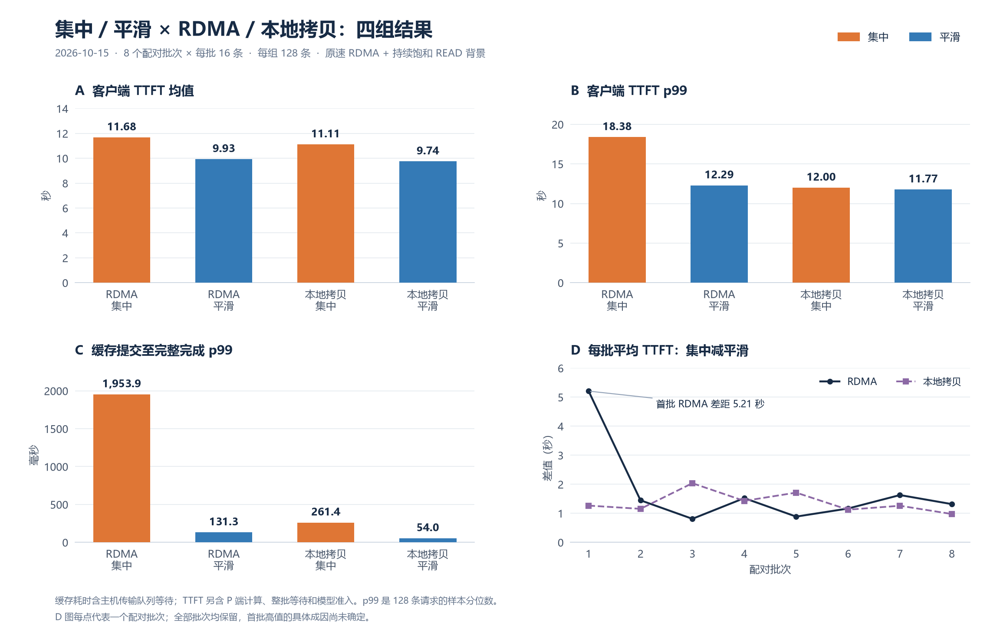
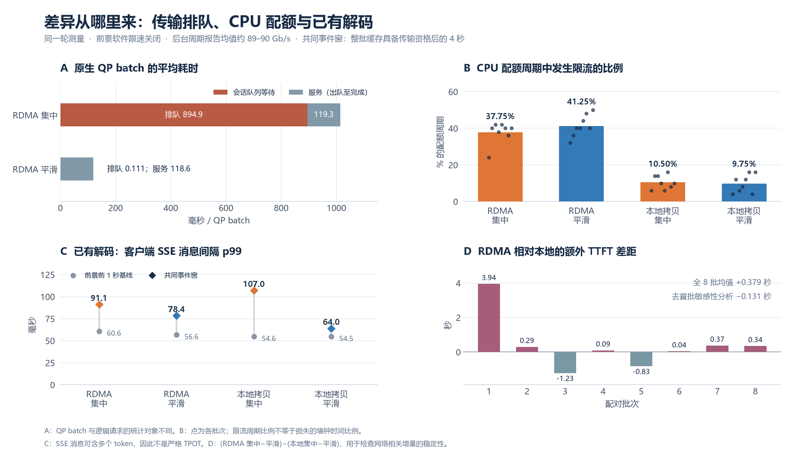

# Issue #23：原速 RDMA 竞争下的十六请求现象实验

[阶段索引](issue23-stage-20261015.md) · [公开审查材料与复核命令](../../results/issue23/20261015-contention/README.md)

本轮研究集中和平滑的缓存访问到达，如何改变共享资源争用、缓存完整可用时间、新请求 TTFT 与已有解码的执行节奏。四组为 RDMA 集中、RDMA 平滑、本地拷贝集中、本地拷贝平滑；模型、对象、命中状态、后台竞争与平均释放偏移保持配对一致。

## 工作负载与运行预算

- 两节点各两张 Ascend 910B2；Qwen3.5-35B-A3B，BF16、TP=2，revision `59d61f3ce65a6d9863b86d2e96597125219dc754`。
- 使用已验收的 ACL Graph FULL_DECODE_ONLY 与异步调度。模型槽位 24；每节点主机池 8 GiB；每卡 attention cache 4 GiB。
- 每批 16 个不同输入；输入/复用/输出预算分别为 4097/4096/1 token。每请求完整混合缓存包含四个 storage group、两个 TP rank，148,275,200 字节；每组每批 2,372,403,200 字节。
- 从已有冻结清单取 128 条不同用例，组成八个配对批次，共计划 512 次前景执行。四组采用四种平衡顺序轮换两轮。
- 四条已有 decoder，短输入 64 token、输出预算 4096；前景开始前先进入解码并采集一秒基线。
- 模型、engine、MetaServer、router 常驻。每批准备一次不可变源状态和 D 端隐藏镜像，四组复用；前景仍走 P/D router，P 端冷 prefill 是请求 TTFT 的组成部分。
- 旧固定 35 秒观察下界改为八秒；同时覆盖最后一个 bundle eligible 后的四秒共同事件窗，并至少保留完成后的恢复观察。慢请求完整追踪，超时为 60 秒；测量阶段预算 600 秒，在下一 arm 开始前检查预算。

## 网络校准与处理条件

网卡 mlx5_2、Ethernet、MTU 1024，perftest 使用 GID index 3。RC READ、1 MiB 消息、四个 QP、每 QP 16 个在途 READ 的六秒容量参考为 90.43 Gb/s payload。软件 81.4 Gb/s 额度的独立六秒校准达到 82.39 Gb/s。

机器上 perftest 的连续模式不支持软件限速。主条件采用独立的持续饱和 RC READ 背景，16 QP、每 QP 16 个在途 READ，循环读取 CPU 注册内存；通过连续报告记录其实际完成吞吐。主条件不施加前景 PegaFlow 软件注入额度，计划的 `rdma_rate_bps=0`。背景开始和持续运行的状态均检查。

主条件背景单独运行的初始两段报告平均 89.325 Gb/s。校准期间 D 端物理端口接收数据按 `port_rcv_data * 4` 与时间差计算，约 98.09 Gb/s，说明链路确实接近满载；端口计数是共享物理口范围，可能包含其他租户，不能与应用 payload 数直接混同。

两个 QP 的额外 READ 探针在背景下达到 9.92 Gb/s。以当前请求载荷的服务时间估计乘 1.2，向上取整得到平滑间隔 144 毫秒，在查看应用结果之前冻结。平滑获得资格的偏移为 0、144、…、2160 毫秒，集中统一为 1080 毫秒，平均释放时刻一致。所有组记录实际提交跨度，保留超出 1 毫秒目标的样本。

背景在前景竞争时的实际份额会变化。本轮名称和记录采用“持续饱和背景”，独立 81.4 Gb/s 校准保留为参考。此两节点配置检验共享端点及同路径竞争，多源交换机汇聚需另行拓扑条件和证据。

## 遥测与分析

保存客户端 SSE/usage、完整对象 eligible/posted/completed、软件额度状态、模型首次工作量、worker load 生命周期、H2D 和模型 step 时序、逐组窗口边界，以及后台 perftest 周期报告。每秒采集 cgroup、RDMA 端口及 hw_counters、engine/model 指标。计数覆盖 ECN/CNP、重传等可读字段；计数缺失或未增加时按实际情况报告。

TTFT 使用客户端单调时钟。缓存阶段与模型 step 使用同一 D 节点的原始时间戳。SSE 的局部事件窗按客户端与 D 的墙钟对齐，需明确时钟范围。每组报告完整 TTFT、缓存访问和传输完成分布；共同四秒事件窗另外报告解码 step 与 SSE 间隔，并与一秒背景基线并列。请求、step 和 token 具有批次内相关性，本轮作为设计调整阶段的短时结果，不以 token 数冒充独立实验次数。

完整缓存验收要求：每条请求的全部载荷完成；两 TP rank 首次工作为 `computed_tokens=4096`、`scheduled_tokens=1`。重点为性能与明确的执行语义。

原生二进制与 Python 扩展复用此前已验收版本，运行记录保存身份。Python 运行器支持 16 条分批、独立后台流和共同事件窗。定向工具检查 19 项及 Ruff 通过；本轮最终计数与结果以归档分析为准。

共享目录：`/data/shared_upload/hust-zsx/issue23-contention-20261015`。本地记录位于 `handoff/issue23-contention-20261015`。P 工作区在主测试前曾停止，恢复后重新加载 P 服务，D 服务持续使用；中断和校准错误日志单独保留。

## 完成结果

八个配对批次全部完成，四组各 128 条，共 512 次前景执行；包含 118 个 MMLU-Pro、10 个 FrontierScience 不同用例。它们经过固定长度扩充，只用于性能负载。第一个批次准备到最后一个观察窗结束用时 570.59 秒，即 9 分 31 秒；此计时包含批次源状态准备及 32 个 arm，模型加载、网络校准和此前平台中断另计。

| 组别 | TTFT 均值（秒） | TTFT p99（秒） | 提交至完整缓存完成均值（毫秒） | 提交至完整缓存完成 p99（毫秒） |
|---|---:|---:|---:|---:|
| RDMA 集中 | 11.677 | 18.379 | 1072.73 | 1953.88 |
| RDMA 平滑 | 9.930 | 12.290 | 118.86 | 131.29 |
| 本地拷贝集中 | 11.112 | 12.001 | 187.52 | 261.37 |
| 本地拷贝平滑 | 9.744 | 11.773 | 29.51 | 53.99 |

每条请求完成载荷均为 148,275,200 字节。每组两个 TP rank 的 256 条首次模型工作记录全部为 `computed_tokens=4096`、`scheduled_tokens=1`，没有发现整段 prefill 回退重算。每条前景请求的输出预算为一个 token，已有 decoder 的连续执行单独观测。

### 排队现象及归因

RDMA 集中组的完成 p99 约为平滑组的 14.9 倍。两组各有 256 个原生 QP batch；集中组 batch 平均排队 894.87 毫秒、平均服务 119.29 毫秒，平滑组分别为 0.111 毫秒和 118.55 毫秒。服务时间基本相同，完成时间差主要来自主机侧传输会话队列。原生实现每个 QP 逐个处理 batch、等待其完成后再处理下一个，集中到达会直接积累队列；这部分由计数器和实现共同支持。

背景是独立的真实 RC READ 流量。RDMA 两组前景窗口重叠的后台周期报告均值约为 89.11、89.01 Gb/s，本地两组约为 90.14、90.34 Gb/s；这不是固定比例的带宽保证。共同事件窗附近的 D 物理接收口约为 97.62～98.06 Gb/s。共享端口的 ECN marked packet、CNP sent/handled 增量均为零，部分重传相关计数增加；它们包含后台与其他可能的共享流量，不能按本轮前景请求归属。因此，本轮支持“持续共享链路竞争下，集中到达放大端点排队”，尚不足以证明交换机内部队列或多源 incast 的具体机制。

### 端到端和已有解码

两个后端均为八批中的八批集中组平均 TTFT 更高。RDMA 的配对均值差为 1.747 秒，本地拷贝为 1.368 秒；网络与到达方式的差分约为 0.379 秒。第一批 RDMA 集中组明显较慢，保留全部原始样本；仅作敏感性分析时，去掉首批后的差分为 -0.131 秒。网络特有的端到端 TTFT 增量尚不稳健，不能将全部 1.747 秒差距都归因于网络。

本地拷贝的提交完成也明显受集中程度影响，且集中组缓存完成至首次模型工作平均为 1.854 秒，平滑组为 0.688 秒；RDMA 对应为 1.499、0.789 秒。这说明缓存恢复、模型准入和执行的重叠也是 TTFT 的重要组成部分。原始 TTFT 含约 2.88～2.90 秒平均批次等待，单独减去该等待后的均值依次为 RDMA 集中 8.774 秒、平滑 7.051 秒，本地集中 8.232 秒、平滑 6.866 秒；此减法是算术分解，不能代表重新安排请求后的真实运行。

共同事件窗内已有 decoder 的 rank-0 model-work 事件间隔均值，RDMA 集中/平滑为 28.67/27.93 毫秒，本地集中/平滑为 23.17/23.83 毫秒。客户端 SSE 消息间隔 p99 分别为 91.07/78.45/107.03/63.96 毫秒。SSE 消息可以包含多个 token，消息间隔不是严格的逐 token TPOT；模型工作记录也按事件观测，不将其直接替代硬件 kernel 时间。

D 容器共同事件窗平均使用约 6.76～7.18 个 CPU 核。RDMA 集中/平滑的 CPU 配额周期中，约 37.75%/41.25% 曾触发限流，本地为 10.50%/9.75%。这是发生限流的周期比例，不是损失的墙钟时间比例。CPU 额度竞争构成解码结果的混杂因素；本轮可以描述联合干扰，尚不能单独把已有解码的变化归因于网络。

### 证据边界与下一次对照

本轮是八个配对批次的设计试验，每组仅 128 条，p99 对极端样本敏感。集中提交跨度：RDMA 中位数 0.137 毫秒、最大 1.627 毫秒，其中一批超出 1 毫秒目标；本地中位数 3.305 毫秒、最大 6.901 毫秒，八批均超出目标。数据全部保留，结论采用实际集中跨度。

下一次优先保持 16 条及本轮输入，补充无竞争条件，并隔离 CPU 竞争：为 perftest 与推理进程留出独立 CPU 额度/核，持续记录 cgroup 限流；使用预先固定的预热流程覆盖完整 P/D 前景路径。先验证服务时间、主机排队与模型准入的各自变化，再扩大批次数。当前证据已足以指导该对照，32 条扩容可在 CPU 干扰受控后评估。

## 归档与收尾

完整原始归档为 `pilot-01-evidence.tar.gz`，46,408,617 字节，SHA-256 为 `b303269f4870b497e4c737cbb3fa88332d19f83999a94b4f9bceaf228e345018`。包含 2721 个文件：实际执行源码、冻结用例/配置、32 组窗口、原始日志、SSE、模型与网络遥测、校准、原生制品身份、分析器及服务退出记录。CPU 和用例组成的补充分析位于同目录 `analyze_context.py`、`pilot-context-analysis.json`。控制凭据保留在运行环境私有文件中。

`pilot-analysis.json` 保存四组分布、配对批次、完整载荷/模型工作验收、队列及服务指标、提交偏差与端口计数。原始 contract 的 `transport_model` 沿用了旧文字，执行条件由 `rdma_rate_bps=0` 及配置日志确认；分析中已注明，后续运行器按实际条件生成该字段。

本轮清理先关闭 READ 服务端，客户端随后产生的 perftest 退出错误发生在最后观测窗之后。后续清理顺序改为先停客户端。两台机器本轮模型、engine 和后台负载均已停止，`npu-smi` 确认没有 NPU 运行进程；工作区仍由用户管理。

定向工具检查 19 项、修改脚本的 Ruff 及 `git diff --check` 通过。源码和结果保存在当前工作分支，硬件运行版本以归档为准。
