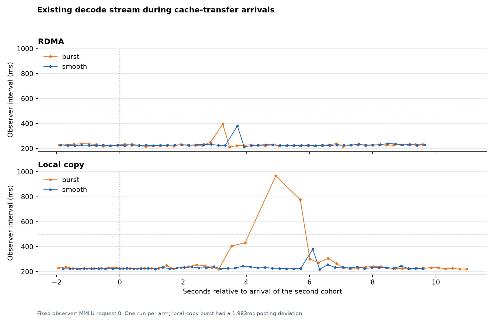

# Issue #23：运行数据复核与下一轮实验设计

本报告基于 2026 年 10 月 14 日四组实验的客户端 SSE、模型/连接器遥测、
native trace、engine 日志和资源采样，并参考官方测量文档与实验设计文献。
所有数字为已归档的一轮数据；下一轮配置为建议方案。

## 结论与研究问题

当前不能估计随机波动是否大于真实效应：每个 arm 只有一次进程执行、两个
cohort，缺少重复执行的方差数据。更重要的新发现是，前景 TTFT 与已有请求
解码平稳性可能存在取舍。应检验这种取舍的方向、大小及可重复性。

下一轮需要回答三个具体问题：

1. 集中/平滑提交如何改变网络或 CPU 拷贝的完成节奏？
2. 在可重复的解码负载下，新缓存恢复是否扰动已有请求的 token 输出？
3. 解码平稳性的改变，以多少新请求 TTFT、吞吐或排队开销为代价？

每一个环境条件均完整运行原四组：`rdma-burst`、`rdma-smooth`、
`local_copy-burst`、`local_copy-smooth`。模型、TP、源快照、输入与输出预算、
到达序列、缓存状态和默认 OS 调度保持配对一致。

## 本轮新增的证据

### 已有解码请求的间隔

第一批四条 MMLU 请求在第二批 FrontierScience 到达时仍在解码。
以第二批的客户端到达时刻划分窗口，对第一批请求的后续输出间隔统计：

| arm | 原前景 TTFT 均值（s） | 已有解码间隔均值（ms） | 间隔 p95（ms） | 间隔最大值（ms） | 大于 500 ms 的间隔数 |
|---|---:|---:|---:|---:|---:|
| RDMA / 集中 | 3.217 | 230.6 | 249.2 | 396.0 | 0/171 |
| RDMA / 平滑 | 3.454 | 231.2 | 237.7 | 386.0 | 0/170 |
| 本地拷贝 / 集中 | 3.289 | 274.8 | 431.6 | 967.1 | 8/168 |
| 本地拷贝 / 平滑 | 4.597 | 234.2 | 253.8 | 384.8 | 0/167 |

这些是客户端接收到的连续输出间隔。已核实第一批四条请求的每个被统计
输出事件均携带一个 token，因此本次可以作为 ITL 观察。四条请求共享计算
批次，同一停顿会同时表现为四个间隔；8 个长间隔不是 8 个独立干扰事件。
表中窗口包含第二批的 P 端处理、缓存传输、恢复及后续计算，并非纯 DMA 窗口。
vLLM 的官方说明也明确区分流式输出间隔 ITL 与逐请求 TPOT 的统计口径。
[vLLM latency metrics](https://github.com/vllm-project/vllm/blob/main/docs/benchmarking/cli.md#understanding-the-latency-metrics)

图示固定使用 MMLU 请求 0，其他三条请求呈现相近停顿。横轴全部来自同一个
客户端时钟。图与表都属于单轮观察；本地拷贝集中组仍保留一次提交跨度
1.983 ms 的时序资格标记。

本地拷贝平滑组的新请求更晚开始计算，同时已有解码更平稳。这与“优先保持
已有解码、缓存恢复受到延后”的机制相容；需要重复对照才能确定因果关系。
仅看新请求 TTFT 会遗漏这种可能的成本/收益取舍。

### 传输与恢复阶段

| arm | 同组最后完成时刻相对 Tg（两个 cohort，ms） | FrontierScience 的较慢 rank H2D task（ms） |
|---|---|---:|
| RDMA / 集中 | 68.90 / 66.85 | 98.30 |
| RDMA / 平滑 | 52.16 / 51.95 | 509.04 |
| 本地拷贝 / 集中 | 60.13 / 58.31 | 207.04 |
| 本地拷贝 / 平滑 | 61.99 / 59.46 | 2905.56 |

这里的 native H2D task 包含描述符构建、H2D 调用和 stream 同步。它不是纯
设备 DMA 时间。每个 FrontierScience 恢复 task 都有 400 个 copy 描述符、
296,550,400 字节/TP rank。本轮日志中没有 batch API 失败或同步 memcpy
fallback 的警告，不能把长恢复直接归因为 fallback。

本地拷贝平滑组的 host→NPU 恢复慢尾与已有解码的平稳输出同时出现。
下一轮应拆分 H2D API 提交耗时、设备完成事件、同步等待和通知延迟，定位
到底哪个环节被已有负载影响。

CANN 的设备 stream 优先级影响设备调度，但不能抢占已执行任务，也不能
保证绝对执行顺序；它与 Linux SCHED_FIFO 是不同机制。本轮使用默认 stream
创建和 SCHED_OTHER。首先保持这些参数一致并测量，设备优先级可留作后续
独立因素。[CANN stream priority](https://www.hiascend.com/doc_center/source/en/CANNCommunityEdition/910/others/acldevg/runtime_doc_dev_0016.html)

### 资源与遥测负担

测量窗口中 D 端 cgroup 约使用 3.84–3.90 个 CPU 核等价的时间，额度为
`800000/100000`（8 核）；采样端点之间 `nr_throttled` 增量均为 0，内存约
21.36–21.59 GiB，未记录 OOM 事件。这不支持把本轮秒级慢尾主要解释为
已观察到的 D 端 cgroup CPU 限流或内存不足；也不能排除运行队列、NUMA、
设备调度及其他租户的影响。

资源采集器单次 wall span 的中位数约 34–37 ms，最慢约 584–612 ms，较长
采样通常含 `npu-smi`。这是采集墙钟耗时，不等同于 CPU 使用或模型停顿。
详细日志和外部工具可能产生测量负担，需要简短的遥测等级配对校准。

## 本轮设计的限制

1. **重复单位不足。** 同一 cohort 共享 Tg、NIC、恢复任务和模型批次；每组
   八条请求并非八次独立实验。两个 cohort 的全部 token 间隔也不能作为独立
   样本计算极窄置信区间。
2. **背景负载未固定。** cohort 间隔 8 秒，但端到端平均约 18–19 秒；第二批
   到达时第一批尚未结束。不能用它代替一个事先冻结的解码负载条件。
3. **数据集与时间位置绑定。** MMLU 总在前、FrontierScience 总在后；类别、
   prompt 尾部长度和是否存在已有解码负载耦合。四请求剩余 prompt token
   也从 1 到 15 不等。
4. **只汇总 TTFT 不够。** 相同传输量下，平滑可能降低已有解码的慢尾，同时
   延后新请求恢复。这需要同时报告 ITL、TTFT 与吞吐。
5. **固定 arm 顺序。** 本轮顺序是 RDMA集中、本地集中、RDMA平滑、本地平滑。
   温度、代码缓存及外部负载的时间漂移可能与处理方式绑定。
6. **完成通知不够独立。** `run_cohort` 的平滑分支在提交完四个 slot 后才送回
   pending 列表，随后两种分支都逐个 await `finish_post`。RDMA平滑两组的
   slot 0/1 完成观察都集中在 Tg+30 ms 附近。当前没有独立的最早 CQ 完成
   时间，不能将观察时间直接当成物理传输结束时间。应逐 bundle 并发监测
   完成并通知，同时保持 staged buffer 到真实完成为止的生命周期。
   另外，集中使用四个blocking提交任务，平滑使用一个专用提交线程；应
   统一预启动worker池、优先级和可用CPU，并记录提交路径成本，使释放
   时刻成为明确的主要变化。
7. **扩大一张冻结清单会碰到容量。** 本轮每条完整 bundle 约148 MB，128个
   不同请求约19 GB逻辑数据，超过4 GiB host pool，hidden快照和staging还
   有额外占用。增加样本应采用可重复、容量有界的 trial/epoch。
8. **重启成本过高。** 四组每组总用时246–310秒，其中测量25–29秒；只增加
   重启轮数会把大部分资源时间用于模型加载。

## 下一轮分阶段方案

### A：无背景请求的四组校准

目的：测清集中/平滑对缓存获取、恢复和前景首 token 的影响。

- 使用完整混合缓存、每cohort四个独立cache salt，固定4097个输入token，
  复用4096 token，前景输出1 token。MMLU/FrontierScience均作为文本来源。
- P端按相同序列产生状态并冻结源快照，D端准备hidden快照；进入测量前
  清理可见host/device缓存，确认前景将真实触发外部恢复。
- 每个trial开始时D端无运行请求，上一trial全部完成后再开始下一trial。
  P冷prefill与既存源快照恢复分别计时。
- 主指标为Tg→全部bundle完成、Tg→D端首token、H2D耗时及原客户端TTFT；
  人工等齐等待单列。

### B：固定四条已有解码请求的四组对照

目的：验证缓存恢复对已有解码的干扰，以及前景TTFT的代价。

- 保留阶段A的四个前景请求；背景为四条固定短prompt、固定seed、固定输出
  预算的已有D端解码请求。最大并发仍为8，不提高OS调度优先级。
- 前景snapshot准备和全局cache reset在启动背景请求前完成，避免运行中
  重置背景缓存。每个trial都重新建立相同的背景状态。
- 背景输出预算可先用256 token，并明确达到同一已生成token数后再注入
  四条前景请求；注入的模型step相位在配对block内相同、跨block随机化。
- 以已实际生成的token计数确认四条背景均处于decode；固定观察窗从注入
  前2秒延伸至前景完成后2秒。背景退出和trial间drain需显式记录。
- 同时报告背景ITL p95、超过500 ms的比例、最大停顿、TPOT；前景TTFT、
  H2D完成延迟、cohort完成耗时；以及整体输出吞吐。500 ms来自本轮诊断，
  应在新一轮前冻结，作为研究阈值而非已存在的产品SLO。

优先比较“没有背景”与“四条固定背景”两种环境。若差异随背景负载改变，
可进一步测背景并发2；不把未固定的前一批请求当作背景条件。

### C：端到端稳定负载验证

机制重复后，再使用现有输入长度分布、固定64-token输出和开放到达序列，
完整回放四组，评估吞吐、TTFT、ITL和达标率。

先标定系统持续完成能力；到达率在其约30%、60%、85%三档探索。同一档
四组回放同一份预生成到达trace。请求间隔不能依赖前一次完成时刻，否则
较慢arm会自动承受更低到达压力。MLPerf Server采用开放的Poisson到达来
测服务器负载；此处可参考原则，保留本实验四请求cohort结构，随机化cohort
到达而非依赖完成反馈。[MLPerf Inference rules](https://github.com/mlcommons/inference_policies/blob/master/inference_rules.adoc)

探索负载范围后，用另一批seed和预先冻结的负载点进行确认。稳定无差异也
应完整报告；避免只保留差异最大的压力点。

## 配对、采样与停止准则

先使用原10 ms平滑间隔，集中时刻仍为Tg+15 ms。若探索5/10/20 ms间隔，
对应集中时刻应为Tg+7.5/15/30 ms，保持平均提交偏移相同。任何payload或
并发变化都要在同一环境下完整执行四组。

payload可先用4K checkpoint；需要测8K时，四组统一使用至少16K的context
上限并固定同一运行配置，输入改为8193 token、仍只重算一个尾token。
记录真实计划字节数，不用“输入长度翻倍”替代实际传输量。

将相同输入、源快照、背景状态和机器运行期组成一个配对block，在block内
比较四组。采用四行平衡顺序：

| 顺序 | arm顺序（A=RDMA集中，B=RDMA平滑，C=本地集中，D=本地平滑） |
|---|---|
| 1 | A B D C |
| 2 | B C A D |
| 3 | C D B A |
| 4 | D A C B |

四行使各arm各占一个时间位置，并覆盖全部12种相邻有序pair。随机化四行
的执行顺序，跨block置换请求slot和文本类别；比较始终在同一输入配置内。
这对应控制可控干扰、随机化其余因素的分块实验原则。
[NIST randomized block designs](https://www.itl.nist.gov/div898/handbook/pri/section3/pri332.htm)

采样建议：

1. 先做8个完整配对block的重复性试验，重点看逐block效应、置信区间与
   是否存在冷启动/时间漂移。这个数是起点，不是显著性的保证。
2. 对有希望且预先选定的条件，每个block可加入16个容量有界的四请求
   trial。8个block共512个前景请求/arm；它们仍有block内相关性。
3. 用block级配对差异或比值汇总，并按block/执行层级重采样，不能将
   所有request或token当独立样本。若同一进程复用，需另做少量新进程
   block检查进程间变异。
4. 预先确定实用效应阈值，例如背景ITL改善至少10%且前景TTFT代价不超10%。
   对照CI宽度与该阈值决定增加哪一层重复；确认阶段的采样预算在新数据
   之前冻结。不要看到某次显著结果就停止。
5. p99需要更多尾部观察及可接受的区间宽度；每条件1000条请求只提供约
   10个最高1%位置的样本，不能单凭总数宣布p99稳定。

性能测量应根据进程间和迭代间变异决定重复层级，先达到初始化后的状态，
并报告效应区间。此处参考
[Kalibera & Jones, Rigorous Benchmarking in Reasonable Time](https://kar.kent.ac.uk/33611/45/p63-kaliber.pdf)。

## 所需实现与遥测

实施顺序建议如下：

1. **trial/epoch重置与容量管理。** 在所有原生传输、H2D、lease和请求均
   完成/退出后，重置gate身份和目标缓存，为同一冻结状态准备下一trial。
   以运行期保持模型、每trial重新准备缓存的方式降低启动成本。
2. **完成观察独立化。** 每slot提交后即开始跟踪完成；四个bundle并发
   等待。为RDMA增加真实CQ完成标记，为CPU copy保留实际结束标记；
   分别记录ready通知发出和D端收到的时间。
3. **H2D细分。** 记录task入队/出队、描述符构建、API进入/返回、设备事件
   完成、stream同步、完成通知、rank和request/epoch关联。CPU与设备计时
   明确标注，避免把driver等待当作DMA带宽。
   同时保存PCI/NPU/NUMA拓扑、允许CPU集合、pinned pool的实际NUMA页分布
   和各rank的CPU亲和性。现有全局pool关闭了NUMA绑定，进程复用可以保持
   同一block内的内存布局；发生重新分配时要在所有arm中保持一致。
4. **模型与观察者时钟。** 增加D端首token与每token事件、当前解码数量、
   batch组成、scheduled token数。D端gate→首token用同节点时钟；原始
   客户端TTFT与ITL保持原口径。
5. **低负担测量与详细诊断。** 主测量保留必要事件和1Hz cgroup采样；
   native大manifest以hash标识并外置一次，npu-smi与详细trace在诊断重复
   中采集。做一次等级配对，记录其对ITL/TTFT的影响。
6. **资格状态与结果保留。** 缺组、字节/清单错误、显式load失败需诊断；
   提交时序偏差单列并保留原始样本，其他arm继续采集。主分析同时报告
   intention-to-schedule的全部样本与预先规定的时序合格子集，避免事后
   选择有利样本。模型输出数值差异继续作为独立观察。

准备状态、cache miss和真实4096/8192 token复用必须有证据。官方vLLM
benchmark文档提示，重复相同prompt会触发APC并改变吞吐；本实验要保证
每轮前景确实走所指定的缓存恢复路径。
[vLLM benchmark cache caveat](https://github.com/vllm-project/vllm/blob/main/docs/benchmarking/cli.md)

## 工作区控制与材料

已配置的Coder CLI提供`coder start hust-zsx-81`、`coder stop hust-zsx-81`
和对应`zsx-91`命令。本次查询显示两个workspace均为running；现有实验
服务已在首轮结束后停止。本次研究未执行workspace启停。启动仍受平台
资源和模板策略约束，内存缓存与运行进程需重新建立，共享源码/结果可复用。

[复核数据](issue23-experiment-redesign-data-20261014.json)包括已有请求间隔、
cohort时序、资源增量、源快照及P端首个实际计算记录。P端测量请求均从
`computed_tokens=0`开始，首chunk为2048或4096 token；D端复用4096 token。
因此当前P端实际执行冷prefill，不能假定它的计算开销已经被预热消除。

原始包SHA-256：
`dd4c9a80553b25ba8347a7229ec635cfae2aecc9d0048a444c4dc9ecda7bcf10`。
