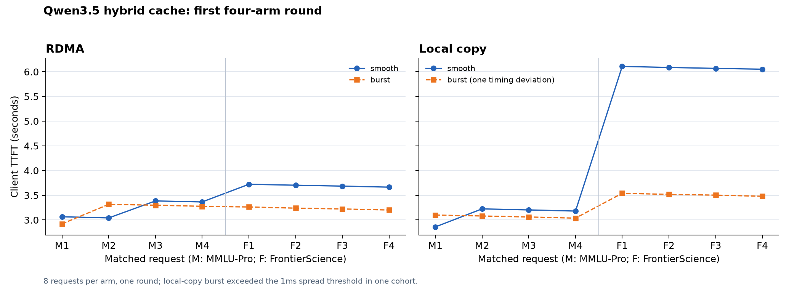

# Qwen3.5 混合缓存四组实验：首轮结果

2026 年 10 月 14 日，81 节点作为 P 端，91 节点作为 D 端，每台各两张
Ascend 910B2。模型为 Qwen3.5-35B-A3B，TP=2、BF16、eager、同步调度。
四组均使用 SCHED_OTHER、优先级 0。

每组回放相同的 8 条请求：4 条 MMLU-Pro、4 条 FrontierScience；固定生成
64 token。输入为 4097–4111 token，两个四请求 cohort 相隔 8 秒，各 cohort
内请求间隔 20 毫秒。完整参数、缓存准备流程和遥测字段见
[实验协议](issue23-hybrid-four-arm-20261014.md)。

## 测量结果

TTFT 和端到端耗时单位为秒；bundle 完成耗时从 native 提交返回到观察到完整
传输完成，单位为毫秒。所有行均保留原始样本。

| 传输 / 提交方式 | 成功请求 | TTFT 均值 | TTFT p50 | TTFT 最大值 | E2E 均值 | bundle 完成均值 | 原门控检查 |
|---|---:|---:|---:|---:|---:|---:|---|
| RDMA / 集中 | 8/8 | 3.217 | 3.251 | 3.316 | 17.626 | 43.870 | 通过 |
| RDMA / 平滑 | 8/8 | 3.454 | 3.524 | 3.722 | 17.885 | 22.884 | 通过 |
| 本地拷贝 / 集中 | 8/8 | 3.289 | 3.289 | 3.540 | 19.461 | 40.949 | 一个 cohort 提交偏差 |
| 本地拷贝 / 平滑 | 8/8 | 4.597 | 4.638 | 6.108 | 19.109 | 32.603 | 通过 |

本地拷贝集中组的两个 cohort 提交跨度分别为 0.552 ms、1.983 ms。后者超过
原实验预设的 1 ms 阈值，因此该组没有通过完整的时序资格检查。其 8 条请求
均成功，传输分组、清单和字节检查通过；性能样本作为附带时序偏差的观察保留。

## 已确认的行为与首轮观察

- 四组共 32/32 条请求成功，均实际生成 64 token。
- 每组均完成 4 个存储组的完整 bundle，总传输量均为 1,186,201,600 字节。
  每组 P 端冻结源快照均为 40 个对象，字节数与冻结清单一致。
- 每组 8 条请求、两个 TP rank 的首个模型计算记录均为 `computed_tokens=4096`。
  D 端只计算剩余 1–15 个 prompt token，未观察到整段 prefill 回退重算；没有
  显式模型步骤错误或传输错误。
- RDMA 平滑组的平均 bundle 完成耗时低于集中组，但本轮客户端 TTFT 更高。
  端到端 TTFT 的变化需要结合 P 端耗时、cohort 等齐等待、恢复到设备和模型
  调度分析。集中组中，较早就绪请求等待其余请求的时间最长约 1.35 秒。
- 本地拷贝平滑组的 FrontierScience cohort 四条请求 TTFT 均约 6.05–6.11 秒，
  相应实际 CPU 拷贝仅约 29–35 ms。该现象已保留模型和资源遥测，当前不能
  将这段延迟归因于 CPU 拷贝本身。

这是每组 8 条请求的一轮测量。当前观察不能支撑稳定的 p99 或因果效应结论。
后续应固定预热流程、交错重复四组、扩大请求数，并量化默认调度下的实际
提交偏差。输出差异作为独立观察，不作为本轮性能样本的逐 token 一致性门槛。

## 归档

汇总数据：[JSON](issue23-hybrid-four-arm-results-20261014.json)。
实现版本为 `3f9f112`，冻结清单 SHA-256 为
`90c1d2ca93da037eb7af70590f796dc8b6edb73bf2cb6b69706e1d1755e1d172`。

服务器原始数据根目录：
`/data/shared_upload/hust-zsx/issue23-four-arm-20261014`。
结果包为该目录中的 `crossnode-four-arm-results.tar.gz`，包含冻结输入与清单、
客户端 SSE、native trace、连接器/模型遥测、资源采样、Prometheus 快照、
进程命令和状态、源码及二进制校验信息。

测量后已停止本次实验创建的模型、engine、MetaServer、router、采集器和
控制 agent；两台机器分配的 NPU 均无运行进程。工作区资源仍保留。
